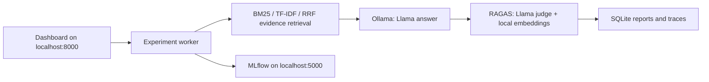
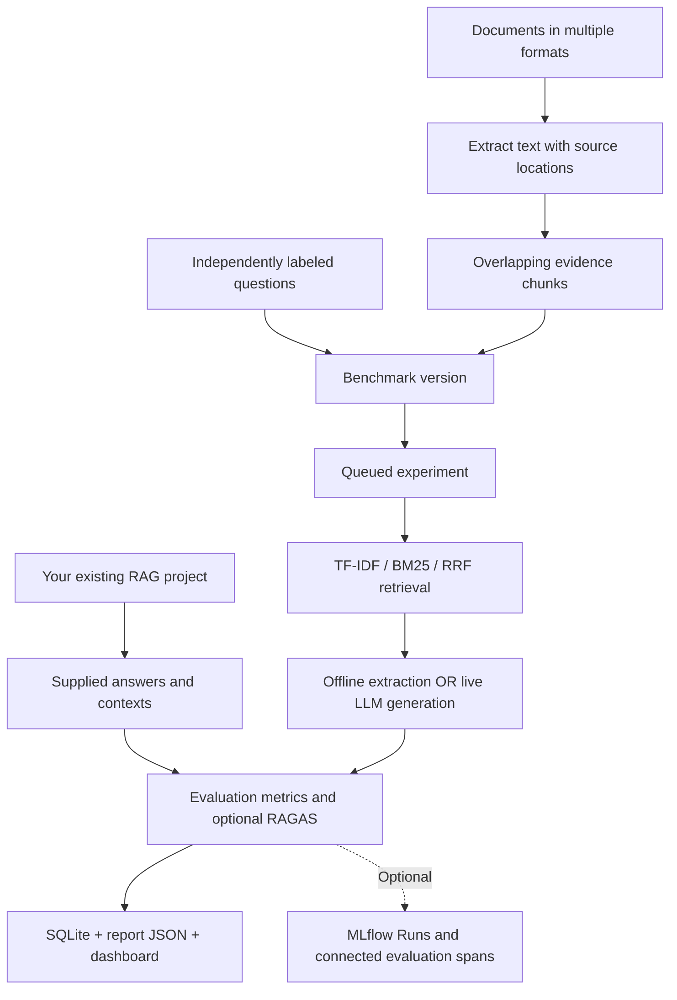

# RAG Observatory

A local evaluation workbench for document question answering: **run experiments from the dashboard, evaluate an existing project's outputs, inspect traces, compare retrieval quality, and optionally publish MLflow/RAGAS results**.

The project measures which configuration works on a labeled question set and helps explain failures. It does not train a neural model. Its default generator extracts sentences from evidence; live LLM generation and RAGAS judging are explicit options.

## Run the complete stack with Docker (local Llama)

Requirements: Docker Desktop running Linux containers, Docker Compose, internet for the first image/model downloads, and enough disk/RAM for the model. This setup uses CPU inference and Llama 3.2 3B as a practical starting point for a 16 GB laptop. Docker Desktop currently has about 8 GB available on the verified machine. GPU acceleration is not enabled by default.

Run these commands **from the `rag-observatory` directory**. Stop native dashboard/MLflow processes occupying ports 8000/5000 first.

```powershell
.\docker.ps1 up -d --build
.\docker.ps1 exec ollama ollama pull llama3.2:3b
.\docker.ps1 exec ollama ollama pull nomic-embed-text
.\docker.ps1 ps
```

Optional one-question integration check after startup (uses only synthetic leave-policy evidence):

```powershell
.\docker.ps1 exec -T dashboard python -u examples/smoke_local.py
```

This submits a real dashboard job with Llama, three RAGAS metrics and MLflow enabled. It creates a small benchmark/run in the Docker database; it is not a measure of model quality. The local judge requests JSON output explicitly because RAGAS validates structured responses. `OLLAMA_NUM_THREADS` defaults to four in the app to limit CPU contention; generation/judge requests have a configurable 600-second timeout. A failed or invalid judge response remains a visible failure, never a fabricated score.

On Linux/macOS use `docker compose` in place of `.\docker.ps1`. The PowerShell wrapper also handles Docker Desktop installations where the bundled Compose executable exists but `docker compose` is missing from PATH.

Open [Dashboard](http://127.0.0.1:8000) and [MLflow](http://127.0.0.1:5000). After model downloads finish, refresh the dashboard. Choose **Example leave policy**, **BM25**, **top-k 1**, **dev**, **Live LLM (ollama / llama3.2:3b)**, then enable RAGAS and MLflow and run the experiment. CPU RAGAS makes several judge requests per question and can take minutes. Start with one or two labeled questions before a larger batch.



The application image is **`rag-observatory:local`**, built from this folder's Dockerfile. Compose runs three services: dashboard, MLflow and Ollama. The app and MLflow run as a non-root user. Only dashboard/MLflow ports are published, both on `127.0.0.1`; Ollama is reached through the private Compose network. This remains a single-user development workbench with one worker and SQLite; containers do not make it a distributed service or add authentication.

Three named volumes persist Observatory runs/uploads, MLflow metadata/artifacts and Ollama model weights. They are separate from the existing native `artifacts/` folder, which remains untouched. Upload documents again in the Docker dashboard if needed. The build context excludes native artifacts, credentials and the virtual environment; private uploaded documents are not baked into the image.

Useful commands:

```powershell
.\docker.ps1 logs --tail 80 dashboard mlflow ollama
.\docker.ps1 stop          # pause; keeps containers and volumes
.\docker.ps1 start         # resume existing containers
.\docker.ps1 down          # remove containers/network; keep volumes
.\docker.ps1 up -d         # recreate using persisted data/models
```

Do not add `down -v` unless you intend to delete the persisted data and model weights. Back up both metadata and artifacts before migration. To change model size, set `GENERATOR_MODEL` and/or `JUDGE_MODEL` in your shell (or a Compose `.env`), pull those model tags, and recreate the dashboard with `up -d`. Model downloads are separate from the application image. Llama is an **open-weight model under Meta's license**; review the [model information](https://ollama.com/library/llama3.2) for intended use. Ollama's [official Docker guide](https://docs.ollama.com/docker) covers GPU configuration.

Using the same small model for answers and judging is a convenient demonstration with correlated failure risks. For credible research, compare to human labels and a stronger, separately chosen judge; evaluate agreement and failure slices before treating scores as reliable. Local inference avoids hosted API charges but still consumes compute. Token usage comes from Ollama's actual prompt/output counters; cost remains **unpriced** unless you explicitly configure rates, and does not measure electricity or hardware cost. Retrieval remains lexical; the local embedding model is used for RAGAS response relevancy, not vector retrieval.

## Verified local setup

Verified on **20 October 2026** in the project's isolated `.venv`; the system Python packages were not changed.

| Component | Installed version | Verification |
| --- | --- | --- |
| Python | 3.13.3 | Project environment and regression suite |
| RAGAS | 0.2.15 | Real faithfulness, response relevancy and context recall metric constructors initialize |
| MLflow | 3.17.1 | Dashboard experiment saved metrics, artifacts and nested traces to the real local server |
| LangChain | 0.3.30 | Compatible 0.3-series dependency stack |
| Document parsers | See version snapshot | PDF, DOCX, PPTX and XLSX extraction tests pass |

The expanded Docker suite has **41 tests: 40 pass and the Windows-only console test skips on Linux**. `pip check` reports no broken requirements. Local Llama generation and RAGAS are supported through Ollama without cloud credentials. The Docker section above describes that setup; hosted provider requests remain untested.

The exact resolved packages are recorded in [requirements-windows-py313.lock.txt](requirements-windows-py313.lock.txt). It is a Windows/Python 3.13 version snapshot without wheel hashes, not a cross-platform lockfile. Use [requirements-live.txt](requirements-live.txt) and [requirements-documents.txt](requirements-documents.txt) for the maintained compatibility ranges.

## Start MLflow and the dashboard

Python 3.11+ is required. The standard-library core runs without downloads or API keys.

The integrations are already installed in this workspace. Start the services in **two separate PowerShell terminals**. If a service is already listening on its port, use the existing service or stop it before starting another instance.

Terminal 1 — MLflow tracking:

```powershell
cd rag-observatory
.\start-mlflow.ps1
```

Terminal 2 — Observatory dashboard:

```powershell
cd rag-observatory
.\start-dashboard.ps1
```

Open [RAG Observatory](http://127.0.0.1:8000), then choose **Run experiments**. The built-in SaaS and leave-policy benchmarks are registered automatically. You do not need to run a CLI experiment first.

The launcher uses `.venv\Scripts\python.exe`, so it sees the project's installed RAGAS, MLflow and document parsers. It accepts `-Port 8001` for a different port. For a core-only setup without a virtual environment, `python -m observatory serve --port 8000` still works.

| Service | Default address | Purpose |
| --- | --- | --- |
| Observatory | [http://127.0.0.1:8000](http://127.0.0.1:8000) | Upload evidence, label questions, launch jobs and compare results |
| MLflow | [http://127.0.0.1:5000](http://127.0.0.1:5000) | Inspect tracked Runs, artifacts and request traces |

The launch scripts use the project environment and UTF-8 mode. Environment activation is optional. Equivalent direct commands, from the project directory, are:

```powershell
# Terminal 1
.\.venv\Scripts\python.exe -X utf8 -m mlflow server --host 127.0.0.1 --port 5000 --workers 1 --backend-store-uri sqlite:///artifacts/mlflow.db --artifacts-destination ./artifacts/mlartifacts

# Terminal 2
.\.venv\Scripts\python.exe -X utf8 -m observatory serve --port 8000
```

For a first check without an API key: select **Example leave policy**, use **BM25**, **top-k 1**, **dev**, **Offline extractive baseline**, enable **MLflow tracking**, and click **Run experiment**. Its completed result appears in Observatory; its tracking data appears under the `rag-observatory` MLflow experiment. Inspect **Traces** for the span tree. Standard experiment Runs are also available through MLflow's model-training view; this project does not submit MLflow-native GenAI evaluation jobs.

To stop a service, press `Ctrl+C` in its terminal. Let active experiments finish before restarting. After a dashboard restart, save/download any unsaved benchmark draft before refreshing the browser, and initialize a new SDK client to obtain the new local session token.

## Dashboard workflow

1. Choose a registered benchmark, or import documents / a labeled benchmark JSON.
2. Inspect extracted chunks and source locations. Add questions with gold evidence IDs and reference answers, or edit the complete JSON.
3. Save your changes as a new immutable benchmark version.
4. Select strategy, top-k, question split, generation mode and optional integrations.
5. Click **Run experiment**. A background job reports progress without blocking the page.
6. Open its result in Trace explorer, Evaluation or Experiments.

A job's `COMPLETE` status means the pipeline finished without request errors. It can still fail quality gates. A failed request produces a `FAILED` run; setup failures produce a failed job without a run. Refresh after experiments started through the CLI or SDK. The job list refreshes automatically while the workbench/integration view is open.

## What it evaluates



Gold answers and relevance labels go to the evaluator, never to the built-in retriever/generator or the SDK's pipeline callback. The corpus may be shared across dev/test questions; the held-out element is the evaluation question set.

## Document formats

Install the optional parsers for PDF and Office files in the environment that runs the server:

```powershell
.\.venv\Scripts\python.exe -m pip install -r requirements-documents.txt
```

| Type | Extraction | Limits |
| --- | --- | --- |
| TXT / Markdown | UTF-8 text | Other encodings need conversion |
| CSV / TSV | Header/value rows, row numbers | Flat text representation, not a spreadsheet reasoning engine |
| JSON / JSONL | JSON content, item positions | Structural semantics are serialized into text |
| HTML | Visible text, excluding script/style content | No JavaScript rendering or URL fetching |
| PDF | Embedded text by page, using pypdf | No OCR; a page with no text explicitly rejects the import |
| DOCX | Body paragraphs and tables in document order | Headers, footnotes, images and complex layouts are not fully represented |
| PPTX | Shape text and tables with slide numbers | No image/OCR content or slide-layout understanding |
| XLSX | First-row headers and cached cell values, sheet/row locations | No formula recalculation; caches may be absent; no chart/image extraction |

Legacy `.doc`, `.ppt`, `.xls`, encrypted PDFs and image files need preprocessing. A format extension being supported does not imply perfect layout extraction. Inspect the evidence preview before labeling. For PDF extraction/OCR limits, see [pypdf's documentation](https://pypdf.readthedocs.io/en/stable/user/extract-text.html).

The dashboard accepts multiple files. Each file is limited to 10 MiB, the batch to 20 MiB and 100 files. Office archives also have a 64 MiB uncompressed-size limit. Unsupported or empty files return explicit errors rather than silently disappearing. Parsing is local; parsers do not execute macros or fetch external sources.

Each chunk retains a source path plus page/sheet/row/slide metadata where available, section index and zero-based word offsets. IDs include a path hash, section index and word start; the full dataset hash detects changed content. Chunk IDs alone are not content hashes. New parser/chunking versions can invalidate old labels.

## Build a benchmark on your documents

You can do this through the dashboard, or use the CLI:

```powershell
.\.venv\Scripts\python.exe -m observatory ingest --documents ./my-documents --output ./artifacts/my-benchmark.json --chunk-words 300 --overlap-words 50
```

Use an input directory containing only supported source files; the importer rejects unsupported files. The default creates windows of at most 300 whitespace-separated words with 50-word overlap within each extracted section. An output file is never overwritten.

The importer cannot invent trustworthy evaluation ground truth. It creates `cases: []`; add independently checked questions before running experiments. A complete, small example is in `examples/benchmark.json`.

```json
{
  "id": "q-dev-001",
  "split": "dev",
  "slice": "direct",
  "question": "What is the annual leave entitlement?",
  "relevant_ids": ["REPLACE_WITH_A_REAL_CHUNK_ID"],
  "reference": "Annual leave entitlement is 24 days per calendar year."
}
```

`split` is `dev` or `test`. Question IDs are unique. Every relevant ID must exist in the benchmark corpus. Use `slice: "unanswerable"` together with `relevant_ids: []` for an intentionally unanswerable question; an empty list never means “not labeled yet.” The reference answer is not copied from a pipeline prediction.

Include direct, paraphrase, multi-hop, adversarial and unanswerable questions. Keep near-duplicates in one split to reduce leakage. Label an explicit evidence-unit policy: requiring every redundant overlapping chunk can distort chunk-level recall. This version does not consolidate equivalent chunks into document-level evidence groups.

Use dev to select settings, then evaluate the chosen configuration on held-out test questions. Include answerable and unanswerable cases in both splits to assess all built-in gates. A missing unanswerable subgroup causes its gate to fail rather than manufacturing a score.

```powershell
.\.venv\Scripts\python.exe -m observatory run --dataset examples/benchmark.json --strategy bm25 --top-k 1 --split dev
.\.venv\Scripts\python.exe -m observatory sweep --dataset ./artifacts/my-benchmark.json --split dev
.\.venv\Scripts\python.exe -m observatory run --dataset ./artifacts/my-benchmark.json --strategy bm25 --top-k 3 --split test
.\.venv\Scripts\python.exe -m observatory compare BASELINE_RUN_ID CANDIDATE_RUN_ID
```

`top_k` must not exceed corpus size. The sweep evaluates TF-IDF/BM25/RRF at k in {1,3,5}, omitting impossible k values. `run` and `sweep` exit 1 on a failed quality gate while preserving results. `demo` generates three bundled dev baselines and intentionally tolerates weak quality gates.

## Integrate with an existing project

Use **Integrations** in the dashboard to submit a JSON array or JSONL file containing answers and contexts your project already generated. This does not replace your retriever or model provider.

For Python projects, install this local package in their environment:

```powershell
python -m pip install -e 'C:\path\to\rag-observatory'
```

```python
from observatory.client import ObservatoryClient

client = ObservatoryClient("http://127.0.0.1:8000")
job = client.evaluate(
    project="support-rag-corpus-v1",
    pipeline_config={"retriever": "your-retriever", "model": "your-model"},
    records=[{
        "case_id": "q1",
        "question": "How many annual leave days are available?",
        "response": "24 days. [policy-1]",
        "contexts": [{"id": "policy-1", "text": "Annual leave is 24 days."}],
        "reference": "24 days.",
        "relevant_ids": ["policy-1"],
        "slice": "direct",
        "latency_ms": 180
    }],
    ragas=False,
    mlflow=False,
)
print(client.wait(job["id"]))
```

The client also offers `evaluate_pipeline(project, benchmark, pipeline, split="test")`. Your callback receives **only the question**, runs locally in your application and returns `{response, contexts}`. The client combines predictions with gold labels afterwards. It works with custom Python, LangChain, LlamaIndex or other frameworks through this explicit output contract; dedicated framework auto-instrumentation is not implemented.

Run the credential-free integration example while the server is running:

```powershell
.\.venv\Scripts\python.exe -m examples.integrate_existing_project
```

External evaluation creates evaluation spans only. It cannot reconstruct your application's original internal retrieval/generation spans. Caller-reported pipeline latency is stored separately from measured evaluation latency. External token usage/cost is unknown in this adapter rather than invented. For full application traces, instrument your application independently with MLflow or OpenTelemetry.

See [the integration API and adapter guide](docs/INTEGRATION.md) for schemas, endpoints, compatibility and data handling.

## Metrics and experiment design

| Metric | Meaning | Important limitation |
| --- | --- | --- |
| Recall@k | Fraction of gold evidence IDs retrieved | Dependent on complete, consistent labels |
| MRR | Reciprocal rank of first relevant result | Can hide missing additional multi-hop evidence |
| nDCG | Binary relevance with logarithmic rank discounts | Normalized at the returned ranking cutoff |
| Lexical F1 proxy | Content-word overlap with reference | Penalizes correct paraphrases; not semantic accuracy |
| Citation validity proxy | Citation IDs present in retrieved contexts | Does not verify support for the associated claim |
| Abstention accuracy | Declines on explicitly unanswerable cases | Phrase-based check recognizes “I do not know” |
| RAGAS faithfulness | Judge assesses claim support in context | A model judgment, not independent truth |
| RAGAS response relevancy | Judge/embedding assessment of question-response alignment | Relevance alone does not establish correctness |
| RAGAS context recall | Judge assesses reference-information coverage in context | Different from ID-based recall |

Unanswerable questions are excluded from retrieval metrics and scored separately. RAGAS skips those cases here. Mean confidence intervals use question-level percentile bootstrap: 2,000 draws, seed 42. Comparisons resample paired recall differences on matching question IDs, dataset versions and evaluator settings. Failed request batches cannot be compared to avoid complete-case selection bias. There is no multiple-comparison correction or clustered bootstrap.

Built-in experiment gates are recall >= 0.90, zero pipeline errors, and perfect abstention on the labeled unanswerable subset. They are point-estimate demonstration gates, not statistical certification. They do not enforce a RAGAS threshold. External batches gate pipeline errors only; inspect other quality metrics separately.

The shipped SaaS benchmark has 16 evidence documents and 24 authored questions, split equally into dev/test. Its small sample size does not establish production quality. The Distribution shift page compares only those built-in cohorts' content-token lengths using PSI; it is not live drift monitoring for uploaded projects.

## Enable live LLM generation and RAGAS scoring

Use **Ollama** for local Llama generation, RAGAS judging and embeddings without an OpenAI API key. The Docker stack below configures this automatically. `live` means a real model call, including a local model; it does not imply a paid API.

For a native dashboard connected to an Ollama installation, first pull `llama3.2:3b` and `nomic-embed-text` using Ollama, then configure the server terminal:

```powershell
$env:LLM_PROVIDER = 'ollama'
$env:OLLAMA_BASE_URL = 'http://127.0.0.1:11434'
$env:GENERATOR_MODEL = 'llama3.2:3b'
$env:JUDGE_MODEL = 'llama3.2:3b'
$env:EMBEDDING_MODEL = 'nomic-embed-text'
$env:MODEL_TIMEOUT_SECONDS = '600'
$env:MLFLOW_TRACKING_URI = 'http://127.0.0.1:5000'
.\start-dashboard.ps1
```

The native environment needs the updated `requirements-live.txt`, including `langchain-ollama`. Ollama must be reachable from the server. The Compose Ollama service has no published host port; use the full Docker stack, or a separate native Ollama installation for native mode.

Refresh the dashboard and choose **Live LLM (ollama / llama3.2:3b)**. Enable **RAGAS judge** and optionally **MLflow tracking**. Generation is enabled when its configured model is present; judging additionally requires the judge and embedding models. Failed requests are reported rather than replaced with offline answers. For saved predictions from any existing application, enable RAGAS on **Integrations**; generation stays in your own application.

For the optional hosted provider, set `LLM_PROVIDER=openai`, `OPENAI_API_KEY`, `GENERATOR_MODEL=gpt-4o-mini`, `JUDGE_MODEL=gpt-4o-mini` and `EMBEDDING_MODEL=text-embedding-3-small` in the native server terminal. Restart the server after changing environment variables. Compose deliberately defaults to Ollama and passes no cloud key.

Equivalent CLI evaluation:

```powershell
.\.venv\Scripts\python.exe -m observatory run --dataset examples/benchmark.json --strategy bm25 --top-k 1 --split dev --mode live --ragas --mlflow
```

The model names are configurable examples; account access may vary. The browser displays server capabilities but never receives the provider key. Environment variables apply to processes started from that terminal. `.env.example` documents variables and is **not automatically loaded**. Keep credentials out of benchmark JSON and source control.

## Install on another machine or rebuild the environment

The current installation was verified on Windows/Python 3.13.3. To create a fresh project environment with compatible dependency ranges:

```powershell
python -m venv .venv
.\.venv\Scripts\python.exe -m pip install -r requirements-live.txt -r requirements-documents.txt
.\.venv\Scripts\python.exe -m pip check
```

To reproduce the recorded Windows/Python 3.13 package versions instead, use `requirements-windows-py313.lock.txt` as the requirements file. That historical snapshot predates the Ollama adapter; install the updated `requirements-live.txt` afterward to add it. Other platforms may need different dependency resolution.

`start-mlflow.ps1` uses the same project environment, stores tracking metadata in `artifacts/mlflow.db`, and serves artifacts from `artifacts/mlartifacts`. Open [MLflow](http://127.0.0.1:5000). Keep that terminal running while using MLflow-enabled experiments.

Validate the installed adapter imports without making paid provider calls:

```powershell
.\.venv\Scripts\python.exe scripts/verify_integrations.py
.\.venv\Scripts\python.exe -m pip check
```

The RAGAS adapter remains pinned to its v0.2.15 API; LangChain packages are constrained to the compatible 0.3 series. RAGAS needs a working judge and embedding provider: either downloaded local models in Ollama or hosted-provider credentials. Installing the library alone does not provide a model service.

Windows launchers/CLI use UTF-8 output so MLflow's Unicode run links do not fail a completed job. The console behavior has a dedicated regression test.

Dashboard controls explicitly select model evaluation and MLflow integrations. `--mode live --ragas --mlflow` enables the same options through the CLI. Built-in RAGAS requires live generation in this implementation; external evaluation can judge existing responses without invoking generation. Judge/provider failures are visible and never silently converted to offline success.

MLflow [Run metrics and artifacts](https://mlflow.org/docs/latest/genai/tracing/app-instrumentation/manual-tracing/) record experiment configurations; connected spans record individual request/evaluation inputs, outputs, statuses and timings. RAGAS uses its pinned [v0.2.15 single-turn API](https://docs.ragas.io/en/v0.2.15/concepts/metrics/available_metrics/faithfulness/), with a configurable judge and embeddings. Offline proxies never masquerade as RAGAS scores.

Live built-in token usage comes from the provider. Offline token counts are labeled word-token estimates. Generator cost remains unpriced unless `INPUT_USD_PER_MILLION` and `OUTPUT_USD_PER_MILLION` are explicitly supplied. Judge/embedding costs, retries and failed-request costs are not fully accounted for. A hard prompt-token budget is not yet enforced.

## Storage, execution and security scope

- `artifacts/observatory.sqlite`: runs, traces, immutable benchmark versions and durable jobs; SQLite WAL with indexed lookups.
- `artifacts/reports/<run-id>.json`: portable run and per-question results.
- Queue states: `QUEUED`, `RUNNING`, `COMPLETE`, `FAILED`, `INTERRUPTED`.
- One worker processes jobs serially. Queued jobs survive restart; previously running jobs are marked interrupted and must be resubmitted. No automatic partial resume, distributed workers or running-job cancellation.
- Up to eight queued/running jobs and 500 questions per job. These are local guardrails, not demonstrated capacity guarantees.
- HTTP run/trace reads use `limit`/`offset` pagination. The dashboard currently displays the latest 100 runs and first 100 traces per selected run. API clients can retrieve further pages.

Use one server process per database. The service listens only on loopback. Host/Origin checks and a local session token protect browser mutations from cross-site requests; the SDK bootstraps the session automatically. This is not user authentication, tenant isolation or a remotely deployable security boundary. Do not expose it publicly without adding an appropriate server/authentication layer.

Local reports retain evidence, questions and responses. Telemetry email/key redaction is deliberately limited. Built-in MLflow-enabled runs upload the entire benchmark artifact. External MLflow evaluation stores supplied answers and context-derived judging data in traces. Live generation/RAGAS sends relevant data to configured providers. Use approved data and destinations; no remote integration is enabled by default.

## Scale and résumé evidence

See [scaling measurements and design limits](docs/SCALABILITY.md) and [the interview/résumé guide](docs/INTERVIEW_GUIDE.md). The current system is a single-host research workbench, not a distributed production monitoring platform.

Reproduce the synthetic retrieval measurement:

```powershell
.\.venv\Scripts\python.exe -m benchmarks.scale --sizes 100 1000 5000 --queries 100
```

This writes `artifacts/scale-benchmark.json`. It measures in-memory retrieval only, not ingestion, HTTP, hosted LLMs, RAGAS, database throughput or concurrent users.

## Tests

```powershell
.\.venv\Scripts\python.exe -m unittest discover -s tests -v
# Or, if pytest is also installed in this environment:
.\.venv\Scripts\python.exe -m pytest tests -q
```

The **41-test suite** covers numerical formulas, optimized/full-scan score parity, paired comparisons, provenance, custom labels, actual optional document parsers, HTTP security/validation, asynchronous jobs/recovery/backpressure, SDK integration, external evaluation, provider readiness, native Ollama token usage and Windows UTF-8 console output. The Windows-only console test skips on Linux; parser tests skip if their optional libraries are absent. Unit-level provider/MLflow contracts use fakes. Real local provider verification uses `examples/smoke_local.py`; hosted generation and RAGAS scoring have not been tested with paid provider calls.

## Troubleshooting

| Symptom | What to check |
| --- | --- |
| RAGAS is installed but its checkbox is disabled | For Ollama, start the service and pull the configured judge and embedding models; for OpenAI, set the server key. Refresh and select live generation for built-in experiments |
| MLflow job cannot connect | Start `start-mlflow.ps1`; check that the server's `MLFLOW_TRACKING_URI` matches its address |
| “Missing local session token” after a restart | Preserve any unsaved draft, refresh the browser, or construct a new SDK client |
| Port already in use | Use the existing service or stop your earlier instance; the scripts also accept `-Port` |
| Upload succeeded but experiment has no labeled cases | Open the benchmark, add questions/references/relevant IDs, save the new version, and select that version when launching |
| No RAGAS scores in an offline result | Expected: offline proxies and RAGAS scores are separate; enable the judge for a supported live/external evaluation |
| PDF needs OCR or an Office parser is missing | Inspect the extraction error; preprocess scanned files or install `requirements-documents.txt` into the server's `.venv` |

## Code map

```text
observatory/
  documents.py     Multi-format extraction and source-aware chunking
  benchmark.py     Benchmark validation and fingerprints
  retrieval.py     Sparse postings index, TF-IDF / BM25 / RRF
  experiment.py    Built-in experiments, slices, bootstrap and gates
  external.py      Evaluate existing pipeline outputs
  integrations.py Ollama/OpenAI generation, RAGAS judge, MLflow setup
  providers.py    Provider configuration and local model readiness
  telemetry.py    Nested spans and limited redaction
  store.py        SQLite benchmarks/jobs/runs/traces
  jobs.py         Bounded durable queue and one background worker
  server.py       Loopback HTTP API and dashboard
  client.py       Framework-independent Python integration client
  static/         Browser UI, no CDN or build step
examples/         Labeled benchmark and runnable integration adapter
benchmarks/       Synthetic retrieval performance measurement
tests/            Numerical, parser, pipeline and HTTP integration tests
docs/             Integration, scalability and interview guides
scripts/          Installed-adapter verification without paid model calls
start-dashboard.ps1  Start Observatory with the project environment
start-mlflow.ps1     Start the local MLflow tracking server
requirements-windows-py313.lock.txt  Verified Windows dependency snapshot
```
