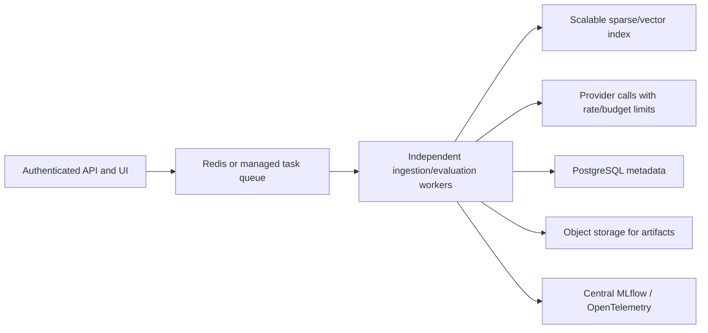

# Scalability: measured scope and remaining limits

This is a **single-host research workbench**. The changes below make local batch evaluation usable and bounded. They do not establish production-scale reliability, multi-user capacity or distributed execution.

## Implemented

| Area | Mechanism | What it accomplishes |
| --- | --- | --- |
| Query scoring | Inverted postings | Score chunks containing query terms instead of scanning every chunk |
| TF-IDF | Cached corpus weights and vector norms | Avoid recomputing document vectors for every question |
| Top-k | Heap selection | Avoid a full candidate sort for TF-IDF/BM25 top-k selection |
| Fusion | Rank fusion of lexical candidates | RRF still needs sorted component rankings |
| Experiments | Background worker | Long generation/evaluation runs do not occupy a browser request |
| Backpressure | Maximum eight queued/running jobs | Reject submissions with 429 instead of growing an unbounded queue |
| Persistence | SQLite WAL + indexed job/trace queries | Durable local statuses with concurrent readers and serialized writes |
| UI/API reads | Limit/offset pagination | Avoid returning all trace records on each dashboard refresh |
| Ingestion | File/archive/chunk bounds | Explicit resource guardrails; not a parser sandbox |

One worker processes jobs serially, including their per-question calls. This keeps the local MLflow run context simple and limits provider pressure. It does not implement parallel provider evaluation or throughput tuning.

Queued requests survive restart. Previously running jobs are marked `INTERRUPTED` and must be resubmitted. Progress counts persist, but individual partially completed job requests are not resumed or replayed automatically. Provider calls may already have incurred charges before an interruption. Run cancellation and cross-process worker coordination are not implemented.

## Local synthetic measurements

Reproduce from the project directory:

```powershell
python -m benchmarks.scale --sizes 100 1000 5000 --queries 100
```

The measured run on Python 3.13.3 / Windows 11 used a fixed seed (42), 81-token synthetic chunks, a 1,000-term vocabulary plus topic terms, 100 serial queries per strategy and k=3. Results are machine/workload specific.

| Evidence chunks | TF-IDF p95 | BM25 p95 | RRF p95 | Index peak Python allocations |
| --- | --- | --- | --- | --- |
| 100 | 0.025 ms | 0.017 ms | 0.072 ms | 1.50 MiB |
| 1,000 | 0.113 ms | 0.092 ms | 0.573 ms | 13.42 MiB |
| 5,000 | 0.957 ms | 0.757 ms | 1.776 ms | 66.32 MiB |

At 5,000 chunks the index build took about 1.61 seconds with tracemalloc enabled. Index memory is the Python allocation peak during construction; it excludes creation of the original corpus, native allocations and total process RSS. Queries are timed with tracemalloc disabled. There is no full-scan speedup percentage reported because an old/new timing benchmark was not run under matched conditions; score parity is tested independently.

The complete measurement, environment metadata and exclusions are written to `artifacts/scale-benchmark.json`. Artifact files are ignored by Git. The numbers above are a recorded example, not a performance SLA.

**Excluded:** file extraction, HTTP and JSON transfer, hosted generation, judge/embedding requests, retries, statistics/bootstrap, SQLite/artifact write throughput, concurrent users and long-running reliability. Therefore these sub-millisecond retrieval numbers are not end-to-end LLM request latencies or supported application QPS.

## Current bottlenecks

1. The complete corpus/index and benchmark JSON live in one worker's memory. Each built-in run rebuilds its index; there is no shared index service or cross-run index cache.
2. Frequent query terms can still touch most documents. RRF sorts candidate rankings, and TF-IDF retains in-memory term weights.
3. Evaluation cases run serially. Hosted LLM and RAGAS calls can dominate runtime and cost.
4. Bootstrap work grows with metric count, question count and 2,000 resamples. It is not incremental.
5. SQLite serializes writers; a network-shared SQLite file or multiple server processes are not supported deployment designs.
6. Reports duplicate evidence across question results; retention policies, trace sampling, compression and artifact object storage are not implemented.
7. Ingestion runs in the request handler and uses bounded in-memory parsing. It is not an isolated parser worker with hard CPU/memory timeouts. File limits do not guarantee every pathological document is cheap to parse.
8. The dashboard lists the latest 100 runs/first 100 traces; clients can paginate further, but the UI is not a large-log exploration system.

## A production evolution, not claimed as implemented



Before adding workers, define idempotency keys, job ownership/leases, retry policy, cancellation semantics and artifact atomicity. Separate parser work from provider work and cap per-provider concurrency. Add corpus/index versions, tenant-aware retrieval permissions, authenticated project access, comprehensive redaction and retention controls.

Use PostgreSQL for shared metadata, a proper queue for distributed job ownership, and object storage for large artifacts. External evaluation already allows the existing application to keep its scalable retriever; Observatory need not own that index.

Measure representative extraction throughput, index memory/RSS, queue wait, p50/p95 generation and evaluation latency, throughput, error rate, cost per successful case and restart/retry behavior under concurrent load. Sweep worker/concurrency counts while respecting provider limits. Test failure recovery and audit duplicate provider calls.

Do not claim this project “scales to millions of documents” until that architecture is implemented and measured on an appropriate workload.
